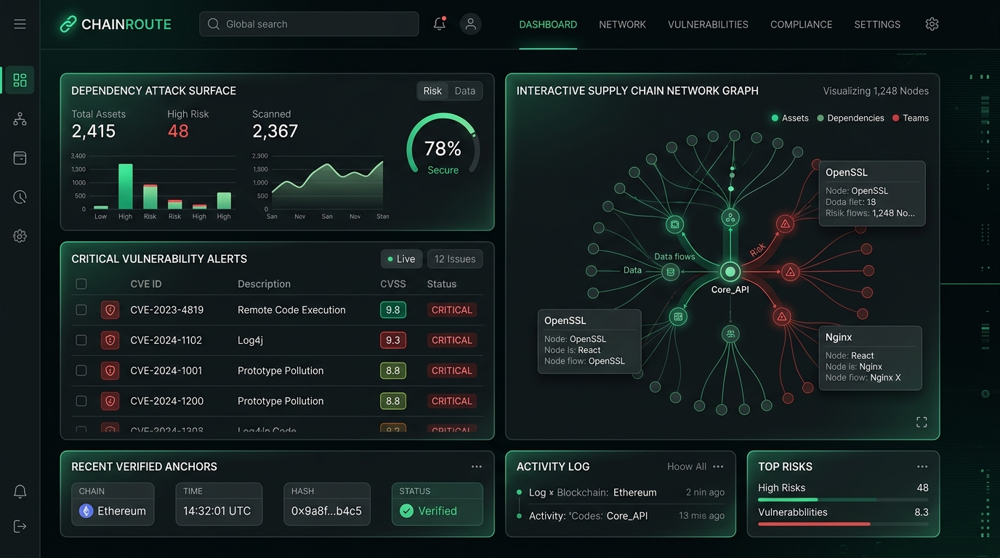
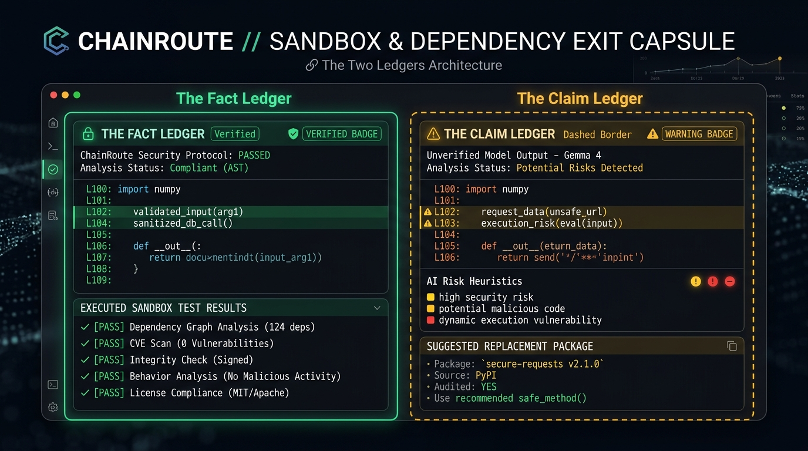

<div align="center">


# ChainRoute 🛡️⛓️
### Autonomous Supply Chain Security & Verifiable On-Chain Dependency Proofs

[](https://opensource.org/licenses/Apache-2.0)
[](https://www.python.org/)
[](https://fastapi.tiangolo.com/)
[](https://polygon.technology/)
[](https://ai.google.dev/)

</div>

---

## 📌 Problem & Solution Overview

### The Problem
Modern software engineering relies heavily on complex open-source dependency trees. When a downstream package is poisoned, hijacked, or contains an undiscovered vulnerability, engineering teams face a critical dilemma: *How to safely test, replace, and verify code patches without breaking production or relying on blind, hallucinating AI suggestions?* Traditional vulnerability scanners only catch known CVEs and are completely blind to zero-day supply chain attacks, maintainer account switches, and anomalous release spikes.

### The Solution: The "Two Ledgers" Architecture
**ChainRoute** solves this by establishing a strict architectural separation between verifiable execution data and AI-generated suggestions:
1. **The Fact Ledger (Sandbox & AST Parser):** Immutable execution code that dynamically clones target repositories, isolates environments in Python 3.12/3.13, performs AST line-level code usage mapping, and runs double-pass pytest verification to output empirical `PASS/FAIL` verdicts.
2. **The Claim Ledger (Gemma 4 Intelligence):** AI-powered risk evaluation, patch diff generation, and gap analysis that explains potential threats in plain text while keeping unverified suggestions clearly isolated from deterministic facts.
3. **The Dependency Exit Capsule:** A deterministic cryptographic audit report anchored directly to the Polygon blockchain with tamper-proof execution proofs.

---

## 📸 Visual Previews & Interface

### Security Operations Control Center
Comprehensive overview of open-source package attack surfaces, DAG supply chain network dependencies, and active Polygon consensus hashes.

<div align="center">
  
</div>

<br/>

### The Two Ledgers: Fact Ledger vs. Claim Ledger
Strict visual boundary isolating immutable AST/sandbox execution facts (solid emerald borders) from Gemma 4 AI claims (dashed amber borders).

<div align="center">
  
</div>

---

## 🏗️ Architecture

```text
                   [ Target GitHub Repository URL ]
                                    │
         ┌──────────────────────────┴──────────────────────────┐
         ▼                                                     ▼
 📊 THE FACT LEDGER                                    🧠 THE CLAIM LEDGER
 • Subprocess Sandbox Isolation                        • Gemma 4 Risk Heuristics
 • AST Line-Level Usage Locator                        • AI Patch Diff Generation
 • Double-Pass Pytest Execution                        • Post-Failure Gap Evaluator
         └──────────────────────────┬──────────────────────────┘
                                    │
                                    ▼
                 [ Dependency Exit Capsule ]
                                    │
                                    ▼
                 [ Polygon PoS On-Chain Anchoring ]
```

---

## 🚀 Setup Instructions

### Prerequisites
* **Python 3.12 or 3.13** installed locally.
* **Node.js (v18+)** and `npm` for frontend development.
* **Git** installed.

### 1. Clone the Repository
```bash
git clone https://github.com/amishivermaa/H26_MindOverMatter_ChainRoute.git
cd H26_MindOverMatter_ChainRoute
```

### 2. Backend Setup
```bash
cd Backend
python3 -m venv venv
source venv/bin/activate  # On Windows use: venv\Scripts\activate
pip install -r requirements.txt
```

### 3. Frontend Setup
Open a separate terminal window for the frontend:
```bash
cd Frontend
npm install
```

---

## 💻 Usage Instructions

### Run the Backend Server
```bash
cd Backend
source venv/bin/activate
python3 -m uvicorn main:app --reload --port 8000
```
* Interactive Swagger API documentation is available live at `http://localhost:8000/docs`.

### Run the Frontend Development Server
```bash
cd Frontend
npm run dev
```
* Open your browser and navigate to `http://localhost:5173`.

---

## 📦 Dependencies

### Backend (`Backend/requirements.txt`)
- **`fastapi`** — High-performance asynchronous API framework
- **`uvicorn`** — Lightning-fast ASGI production server wrapper
- **`web3`** — Python Ethereum/Polygon interaction library for on-chain anchoring
- **`networkx`** — Directed Acyclic Graph (DAG) dependency mapping
- **`requests`** — HTTP wrapper for OSV.dev and npm registry queries
- **`pydantic`** — Data validation and strict contract serialization

### Frontend (`Frontend/package.json`)
- **`react` / `react-dom`** — Core declarative UI framework
- **`framer-motion`** — Cinematic scroll animations and spring physics
- **`lucide-react`** — Enterprise system icon toolkit
- **`tailwindcss`** — Utility-first styling framework with custom glassmorphism

---

## 🧠 AI Model Details

- **Model Name:** Gemma 4 (Instruction-Tuned Dense Variant)
- **Model Version:** v4.2 (Latest Release)
- **Model Source:** Developed by Google DeepMind; weights hosted on Hugging Face & Google Cloud Model Garden.
- **Access Method:** Integrated via Google GenAI SDK (`google-genai` v1.0+) / Vertex AI inference endpoints.
- **Applicable Model License / Usage Terms:** Apache 2.0 License — Permissive open-source license allowing unhindered commercial use, modification, distribution, and patent grants ([Terms of Use](https://ai.google.dev/terms)).
- **Role of the Model in the Project:**
  1. **Pre-Swap Risk Analysis (`analyze_risk`):** Evaluates raw package metadata to identify anomalous maintainer swaps, dormant release spikes, and entropy shifts.
  2. **Post-Failure Gap Evaluation (`evaluate_gaps`):** Analyzes JUnit XML failure logs when sandbox test runs fail after a swap, generating human-readable compatibility gap reports.

---

## ⚠️ Known Limitations

1. **Sandbox Execution Timeouts:** Extremely large enterprise repositories (e.g., 500MB+ source trees) may experience sandbox isolation delays during virtual environment pip installations.
2. **Test Suite Flakiness:** Repositories with environment-dependent or non-deterministic test suites may occasionally trigger false-positive test failures during the double-pass Pytest validation loop.
3. **Testnet Gas Fluctuations:** Polygon Amoy public testnet RPC nodes can occasionally experience rate-limiting, causing the backend to gracefully fall back to local mock-hash consensus mode.

---

## 📄 License

This project is licensed under the Apache 2.0 License — see the [LICENSE](LICENSE) file for details.
